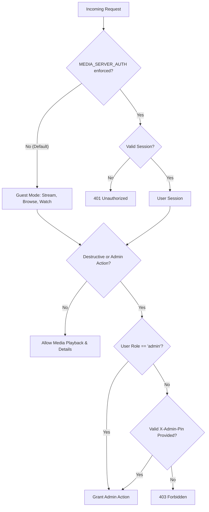

# User Manual & Operator Guide — Anis' Home Media Server

Welcome to **Anis' Home Media Server**, a high-performance, self-hosted personal streaming suite designed for private movie collections across local home networks and remote connections.

This document serves as the authoritative, end-to-end operator manual and user guide covering the full feature suite: web streaming, 10-foot TV & Fire TV Stick controls, mobile gestures, hardware-accelerated dual-GPU transcoding, QR device pairing, user watch history, subtitle customization, LAN/DLNA casting, dual-drive storage tiering, and Windows service management.

---

## Table of Contents

1. [System Architecture & Storage Topology](#1-system-architecture--storage-topology)
   - [Dual-Drive Storage Tiering (E: SSD + D: Mass Storage)](#dual-drive-storage-tiering-e-ssd--d-mass-storage)
   - [Core Service Topology](#core-service-topology)
2. [Accessing the Server & Client Ecosystem](#2-accessing-the-server--client-ecosystem)
   - [Web Browser (Desktop, Mobile & Tablet)](#web-browser-desktop-mobile--tablet)
   - [Universal Android Client (Phone, Fire TV Stick 4K & Android TV)](#universal-android-client-phone-fire-tv-stick-4k--android-tv)
   - [Local Network Streaming (LAN)](#local-network-streaming-lan)
   - [Remote Access via Static IP & Caddy (WAN)](#remote-access-via-static-ip--caddy-wan)
   - [Progressive Web App (PWA) Installation](#progressive-web-app-pwa-installation)
3. [Authentication, Roles & Security Policies](#3-authentication-roles--security-policies)
   - [Guest Mode vs Google Authentication](#guest-mode-vs-google-authentication)
   - [The `MEDIA_SERVER_AUTH` Enforcement Flag](#the-media_server_auth-enforcement-flag)
   - [Administrator PIN Channel](#administrator-pin-channel)
   - [Admin-Only Gated Routes & Protected Capabilities](#admin-only-gated-routes--protected-capabilities)
4. [Device Pairing & Fleet Privacy](#4-device-pairing--fleet-privacy)
   - [The Passwordless Sign-In Model](#the-passwordless-sign-in-model)
   - [OTT QR Device Sign-In (TV & Browser)](#ott-qr-device-sign-in-tv--browser)
   - [Fleet Presence Privacy Scoping & Admin Unlock](#fleet-presence-privacy-scoping--admin-unlock)
5. [Watch Progress, Resume Sync & Watch History](#5-watch-progress-resume-sync--watch-history)
   - [Millisecond-Accurate Continuous Progress](#millisecond-accurate-continuous-progress)
   - [Interactive Watch History Drawer](#interactive-watch-history-drawer)
   - [Continue Watching Rail](#continue-watching-rail)
6. [Library Browsing, Metadata & Uploads](#6-library-browsing-metadata--uploads)
   - [Instant Search & Genre Filtering](#instant-search--genre-filtering)
   - [Movie Details Screen](#movie-details-screen)
   - [Resumable Chunked File Uploads](#resumable-chunked-file-uploads)
   - [Automated TMDb Enrichment & 4-Hour Background Refresh](#automated-tmdb-enrichment--4-hour-background-refresh)
   - [Forensic Media Resolver](#forensic-media-resolver)
7. [Playback Engine: Direct Play vs Dual-GPU Transcoding](#7-playback-engine-direct-play-vs-dual-gpu-transcoding)
   - [Direct Play (Zero-Copy RFC 7233)](#direct-play-zero-copy-rfc-7233)
   - [Dynamic Multi-GPU Chunked Transcoder (AMD RX 560X + Vega 8)](#dynamic-multi-gpu-chunked-transcoder-amd-rx-560x--vega-8)
   - [Instant HLS Cache Detection (< 100ms)](#instant-hls-cache-detection--100ms)
   - [Live Seek Hover Thumbnail Previews](#live-seek-hover-thumbnail-previews)
   - [Stats for Nerds (Technical Telemetry HUD)](#stats-for-nerds-technical-telemetry-hud)
   - [Cinematic Brand Opening Sequence](#cinematic-brand-opening-sequence)
8. [Player Controls, Shortcuts & Remote Navigation](#8-player-controls-shortcuts--remote-navigation)
   - [Desktop Keyboard Shortcuts Cheatsheet](#desktop-keyboard-shortcuts-cheatsheet)
   - [Mobile Touch Gestures](#mobile-touch-gestures)
   - [10-Foot TV Remote Navigation (Fire TV & Android TV)](#10-foot-tv-remote-navigation-fire-tv--android-tv)
   - [Aspect Ratio & Hardware Screen Rotation](#aspect-ratio--hardware-screen-rotation)
9. [Subtitles & Dual-Axis Customization](#9-subtitles--dual-axis-customization)
   - [Dual-Axis Positioning & Controls Elevation](#dual-axis-positioning--controls-elevation)
   - [Live Subtitle Upload (In-Player & Details)](#live-subtitle-upload-in-player--details)
   - [Intelligent Language Auto-Detection](#intelligent-language-auto-detection)
10. [Second-Screen Playback: LAN Cast & DLNA](#10-second-screen-playback-lan-cast--dlna)
    - [Smart TV Casting via DLNA (Samsung Tizen & LG webOS)](#smart-tv-casting-via-dlna-samsung-tizen--lg-webos)
    - [Google Cast (Chromecast & Nest Hub)](#google-cast-chromecast--nest-hub)
    - [In-Cast Volume Sync, Subtitles & Disconnect](#in-cast-volume-sync-subtitles--disconnect)
11. [Storage Retention Policies & Cache Maintenance](#11-storage-retention-policies--cache-maintenance)
    - [Configurable Retention Policies (`keep`, `archive`, `purge_cache`)](#configurable-retention-policies-keep-archive-purge_cache)
    - [Safe Windows-Resilient Orphan Cache Purging](#safe-windows-resilient-orphan-cache-purging)
12. [Windows Persistent Services & Operational Runbook](#12-windows-persistent-services--operational-runbook)
    - [Service Architecture (Rust Axum + Caddy + PostgreSQL via NSSM)](#service-architecture-rust-axum--caddy--postgresql-via-nssm)
    - [Service Restart Instructions](#service-restart-instructions)
    - [Logs & Diagnostics](#logs--diagnostics)
13. [Frequently Asked Questions & Troubleshooting](#13-frequently-asked-questions--troubleshooting)

---

## 1. System Architecture & Storage Topology

### Dual-Drive Storage Tiering (E: SSD + D: Mass Storage)

The server enforces an explicit hardware tiering model separating high-throughput runtime I/O from bulk file storage:

| Storage Tier | Drive & Location | Role & Contents | Performance Characteristics |
|---|---|---|---|
| **Primary Fast Tier** | `E:\MediaServer` | Application code, PostgreSQL data directory (`E:\pgdata`), live seek hover thumbnails (`cache\previews`), in-progress transcode scratch, completed HLS stream cache (`cache\hls`). | Fast NVMe/SATA SSD; guarantees instant seek responses, stutter-free HLS delivery, and sub-100ms database reads. |
| **Secondary Mass Tier** | `D:\Flicks` | Raw video files, cold archives (`D:\Flicks\.archive`), chunk upload staging (`D:\Flicks\.uploads`), deleted-source staging (`D:\Flicks\.deleted`). | High-capacity mechanical HDD or bulk storage; optimized for long-term media preservation without consuming SSD endurance. |
| **Drive C:** | *Not Used* | **Strict Invariant:** Drive `C:` is strictly isolated and never stores project media, databases, or transcode caches. | Reserved for Windows operating system only. |

### Core Service Topology

```text
Browser / Mobile / TV Client
         │
         ├── LAN Ingress: http://192.168.x.x:8000
         └── WAN Ingress: https://media.anisparvez.in
                  │  (Airtel static IP 122.163.124.18, Let's Encrypt TLS)
                  ▼
         Caddy Reverse Proxy (80/443) [NSSM Service: MediaServerCaddy]
                  │
                  ▼
         Rust Axum Server (127.0.0.1:8000) [NSSM Service: MediaServerRust]
                  │
                  ├── React 19 SPA (web/dist/) + native API router
                  │    Routes: /api/*, /media/*, /hls/*, /subtitles/*, /auth/*, /remotelogin
                  ├── Database: PostgreSQL 18.4 (MediaServerPG, port 5432)
                  ├── Hardware Transcoding Pipeline:
                  │    ├── GPU 1 (Discrete): AMD Radeon RX 560X (dx11:1)
                  │    └── GPU 0 (Integrated): AMD Radeon Vega 8 (dx11:0)
                  ├── Storage Engine:
                  │    ├── Fast Cache: E:\MediaServer\cache\
                  │    └── Raw Media Roots: D:\Flicks, D:\Flicks\.archive
                  └── Casting & Second-Screen Engine:
                       ├── DLNA / UPnP Controller (Samsung Tizen, LG webOS)
                       └── Google Cast Controller (Chromecast, Google TV, Nest Hub)
```

---

## 2. Accessing the Server & Client Ecosystem

### Web Browser (Desktop, Mobile & Tablet)
The React single-page application runs on any modern browser (Chrome, Safari, Firefox, Edge) without client software:
- **Local Network (LAN):** `http://<HOST-IP>:8000` (e.g. `http://192.168.1.100:8000`)
- **Remote Access (WAN):** `https://media.anisparvez.in`

### Universal Android Client (Phone, Fire TV Stick 4K & Android TV)
A single universal release APK (`in.anisparvez.media_server_client`) automatically configures itself for touchphones, tablets, and 10-foot TV remotes:
- **Download Link:** Open [`https://media.anisparvez.in/download`](https://media.anisparvez.in/download) or click **Get the app** in the navigation header.
- **TV Direct Installation:** Use the **Downloader** app on Fire TV / Android TV to enter `https://media.anisparvez.in/download` and install the APK directly.
- **Hardware Decoders:** Supports hardware-accelerated MediaCodec video decoding with automatic driver lock prevention on Fire TV Stick 4K (`AFTMM`).

### Local Network Streaming (LAN)
Direct connection over your home Wi-Fi or Ethernet:
- Provides unlimited local bandwidth (no ISP data consumption).
- Allows uncompressed, zero-copy RFC 7233 byte-range playback.
- Instantaneous seeking and lowest possible latency.

### Remote Access via Static IP & Caddy (WAN)
- The server sits behind an **Airtel Xstream Fiber static IP** (`122.163.124.18`) — no CGNAT, so no
  dynamic-IP or tunnel complications.
- **Caddy** (`MediaServerCaddy`) terminates TLS on ports 80/443 and reverse-proxies to the Rust
  backend on `127.0.0.1:8000`. Certificates are issued by **Let's Encrypt** (TLS 1.3) via an
  automated DNS-01 challenge and renew in the background.
- Caddy provides unbuffered HTTP/2 and HTTP/3 streaming and proxies Server-Sent Events
  (`text/event-stream`) without delay — which is what the QR sign-in wait stream depends on.
- The Cloudflare named tunnel is **decommissioned**. The `cloudflared` Windows service has been
  removed, and the Cloudflare DNS record for `media.anisparvez.in` is DNS-only, pointing straight
  at the static IP.
- Router port forwarding is required for **80 and 443 only**. Port `8000` is **not** forwarded, so
  the origin cannot be reached directly over plain HTTP from the internet — every public request
  goes through Caddy and TLS. On your home network you can still use `http://192.168.1.16:8000`
  directly.

### Progressive Web App (PWA) Installation
Install the media server as a standalone application on mobile and desktop:
- **iOS (Safari):** Tap **Share** (`↑`) → select **Add to Home Screen**.
- **Android (Chrome):** Tap menu (`⋮`) → select **Install App** or tap the install pill.
- **Desktop (Chrome/Edge):** Click the **Install** button on the right side of the URL address bar.

---

## 3. Authentication, Roles & Security Policies

The media server features a flexible, multi-tiered authentication and role system designed to balance seamless home streaming with strict administrative security.



### Guest Mode vs Google Authentication

1. **Guest Mode (Default):**
   - In standard household setups, any family member or guest on the network can immediately browse the catalog, stream movies, search, adjust subtitles, and cast to smart TVs without typing credentials.
   - Devices in guest mode are identified by a local hardware device cookie (`ms_device_id`).
2. **Google Authentication:**
   - Users can link their Google Account via Google Identity Services (`/auth/google`).
   - Signing in associates watch progress and preferences with your personal user account.
   - If your Google email is listed in `MEDIA_SERVER_ADMIN_EMAILS`, you are automatically granted the `admin` role.

### The `MEDIA_SERVER_AUTH` Enforcement Flag

- **When `MEDIA_SERVER_AUTH` is unset (default):** Open-door guest mode is active. Read-only streaming endpoints are accessible without login, while destructive administration endpoints remain strictly protected.
- **When `MEDIA_SERVER_AUTH=1`:** Strict enforcement mode is active. Every request requires an authorized session — created by Google sign-in or by QR device pairing. Unauthorized requests are rejected with `401 Unauthorized`.

### Administrator PIN Channel

For situations where an administrator is using a browser without a Google account, or needs quick elevated authorization:
- The server supports an **Admin PIN** configured in server settings (`settings.admin_pin`).
- **Fail-Closed Security Invariant:** The PIN has no default fallback. If no PIN is configured, the PIN channel is completely closed.
- **Header & Body Only:** The PIN is **never** accepted via URL query strings (preventing leakages into proxy logs, edge history, and referrer headers). It is transmitted strictly via `X-Admin-Pin` HTTP request headers or JSON request bodies.

### Admin-Only Gated Routes & Protected Capabilities

The following actions are strictly restricted to administrators (Google Admin session or verified Admin PIN):

| Protected Action | Endpoint / Surface | Security Reason |
|---|---|---|
| **Storage Management & Policies** | `/manage`, `/api/storage/settings` | Prevents unauthorized modification of disk retention rules. |
| **Orphaned Cache Purging** | `/api/storage/audit`, `/api/storage/purge-orphans` | Protects in-progress and cached transcode files. |
| **Permanent Media Deletion** | `DELETE /api/media/<filename>` | Irreversible deletion of original files from disk. |
| **Cold Archival Movement** | `POST /api/storage/archive/<filename>` | Moves original media files into secondary storage. |
| **Media File Uploads** | `POST /api/upload`, `POST /api/upload/chunk/init` | Protects server storage from unauthorized uploads. |
| **Library Re-indexing** | `POST /api/scan` | CPU/GPU intensive background scan. |
| **Household Fleet Telemetry** | `/devices`, `GET /api/devices` | Masks IP addresses and other household device sessions. |

---

## 4. Device Pairing & Fleet Privacy

### The Passwordless Sign-In Model

Typing a Google password on a smart TV, Fire TV Stick or Apple TV with a remote D-pad is
frustrating. The server instead uses a **QR / activation-code sign-in**: the screen that wants to
sign in shows a short-lived code, and a phone that is already signed in confirms it. No password is
typed on the TV, and no long-lived bearer link is minted.

There is **one** pairing path — the QR Device Sign-In card on `/account`. The old "Add device"
token form was removed on 2026-10-23: it minted a 365-day, reusable sign-in link that no client
consumed. Its backend (`/api/auth/tokens`, `/auth/pair`) and the `auth_tokens` table were retired
the same day, so those URLs now return **404**. See
[`Current issues.md`](Current%20issues.md) → Issue 14, fault 6.

### OTT QR Device Sign-In (TV & Browser)

For a camera-less device — a smart TV's built-in browser, a console, a desktop PC you cannot reach
with a keyboard — the server offers the industry-standard **activation code** flow, the same idea
as Netflix's and YouTube TV's *"enter this code on your phone"* screen.

**On the TV or browser (the device that wants to sign in):**

1. Open **Account & Devices** (`/account`). If you are not signed in, the page shows the
   **QR Device Sign-In** panel automatically.
2. The panel displays three things at once:
   - a **QR code** (rendered as a canvas image),
   - a **5-character code** in large monospace type, e.g. `K7R2P`,
   - a **countdown ring** — the code is valid for **2 minutes**, then it silently rotates.
3. There is also a plain URL (`media.anisparvez.in/remotelogin`) for devices whose camera you
   cannot use — type the 5-character code on the phone instead.
4. Leave the page open. The TV waits on a live server-sent-event stream; you do not need to
   refresh it.

**On your phone (the device that has a keyboard):**

1. Scan the QR code with the camera — it opens `media.anisparvez.in/remotelogin` with the pairing
   details already attached — or open that URL manually and type the 5-character code.
2. **Sign in** if you are not already. The QR details survive the sign-in redirect, so the flow
   resumes exactly where it left off.
3. **Name the device.** Give it something you will recognise later — *"Living Room TV"*, *"Bedroom
   Fire Stick"*, *"Office PC"*. There are quick-suggestion chips for the common cases.
4. Press **Pair device**.

**Back on the TV:** it signs in on its own within a second or two, lands on the library, and the
friendly name you chose is stored against it — so it shows up as *"Living Room TV"* in the fleet
list instead of an anonymous browser row.

**Notes**

- The 5-character code deliberately omits lookalike characters (`0`, `O`, `1`, `I`), so it can be
  read aloud or typed without ambiguity. The unambiguous set is `ABCDEFGHJKLMNPQRSTUVWXYZ23456789`.
- The pairing session is **ephemeral**. It lives for 2 minutes, and the 30-day session it mints is
  bound to the account that authorised it, not to the phone.
- If the SSE stream is blocked by a network, the TV falls back to polling the status endpoint
  automatically — no user-visible difference.
- The QR flow is the only pairing path. The Android / Fire TV client does not consume a pairing
  link — it identifies itself with its own device id, and the library is public.

### Fleet Presence Privacy Scoping & Admin Unlock

To safeguard household privacy against cross-device surveillance or IP leakage:
- **Non-Admin View:** Visiting `/devices` displays **only the caller's current device**. Other household devices, their IP addresses, connection types (LAN vs WAN), and specific watch histories are completely hidden.
- **Privacy Notice:** An amber banner (*"Fleet Privacy Scoping Active"*) informs the user that only their current device is visible.
- **Admin Fleet Unlock:** Clicking **Unlock Fleet Telemetry** opens a modal where entering the Admin PIN instantly reveals the entire household fleet table, live activity statuses, and network path telemetry.

---

## 5. Watch Progress, Resume Sync & Watch History

### Millisecond-Accurate Continuous Progress

As you watch any movie, the client automatically dispatches playback heartbeats to `POST /api/progress`:
- **Tracking Frequency:** Progress updates every 5–10 seconds during playback, and immediately upon pause, seek, or navigation.
- **Completion Threshold:** When you reach 90% of the runtime, the movie is automatically marked as **Watched** (`watched = 1`).
- **Resumption Accuracy:** Returning to the movie prompts an instant **Resume from mm:ss** button that seeks to the exact millisecond where you stopped.

### Interactive Watch History Drawer

View and manage your viewing history across all paired devices:
1. Navigate to **Account & Devices** (`/account`).
2. Scroll to the **Viewing History** card and click **Open History Drawer**.
3. A sleek obsidian sliding drawer opens displaying:
   - High-resolution poster artwork.
   - Movie title and release year.
   - Watched date and exact timestamp.
   - Visual progress bar showing percentage completed.
   - One-click resume action button.
4. **Clearing History:** You can remove individual entries or click **Clear All History** to reset watch history for your account.

### Continue Watching Rail

On the home library page (`/`), movies with in-progress watch states (between 10 seconds and 90% completion) automatically appear in the horizontal **Continue Watching** carousel at the top of the screen for one-click instant resumption.

---

## 6. Library Browsing, Metadata & Uploads

### Instant Search & Genre Filtering
- **Live Debounced Search:** Type any keyword into the search bar. The library instantaneously filters matching titles, years, directors, and actors with zero server roundtrips.
- **Genre & Category Chips:** Filter by *All*, *Action*, *Sci-Fi*, *Drama*, *Comedy*, *Thriller*, or *Recently Added*.

### Movie Details Screen
Each movie features a dedicated cinema details page (`/movie/<filename>`):
- High-definition official backdrops and promotional posters.
- TMDb community rating score and release year.
- Age certification badge (e.g. *PG-13*, *R*, *U/A*).
- Complete plot synopsis and director/cast photo credits rail.
- **Technical Media Specs Card:** Container type, runtime, resolution, display aspect ratio, video codec and profile, audio stream format, channel configuration, and total file size.

### Resumable Chunked File Uploads

Upload new media files directly through the browser without needing FTP or SMB shares:
1. Sign in as an administrator, or have the Admin PIN ready. The upload routes are admin-gated: a signed-in admin session works without a PIN; otherwise the browser asks for the PIN once and keeps it for the tab session.
2. On the library page (`/`), click **Upload Media**.
3. Drag and drop or choose a `.mp4`, `.mkv`, `.webm`, `.mov`, `.avi`, or `.m4v` file up to **20 GiB**.
4. *(Optional)* Enter a clean display title if your original file has a cryptic scene name. The original extension is preserved.
5. Leave **Replace an existing file with the same name** off to keep both files; the server appends ` (1)`, ` (2)`, and so on. Enable it only when you intend to replace a same-named file.
6. Click **Start upload**. The browser sends sequential **8 MiB** chunks at the offset the server reports, shows transfer speed and a measured ETA, retries transient network/5xx failures, and can resume from a `409` offset mismatch. **Abort upload** removes the temporary session.
7. At 100% the server verifies the declared byte count, moves the file into the library root, inserts a fallback catalog row, and queues a full library scan. The details page is available immediately; TMDb metadata and artwork enrichment follows.

The upload PIN is sent in the `X-Admin-Pin` request header, never in a URL or query string. The single-file compatibility route (`POST /api/upload`) accepts one file up to **256 MiB**; the browser uses the resumable chunked route for everything.

### Automated TMDb Enrichment & 4-Hour Background Refresh

Upon file upload or library scan:
1. `ffprobe` analyzes the container for video/audio streams, duration, bitrates, and subtitles.
2. The server queries the **The Movie Database (TMDb) API** using title and year heuristics.
3. High-resolution poster and backdrop artwork are downloaded and cached permanently on the SSD (`cache/posters/`).
4. **4-Hour Periodic Worker:** A background daemon refreshes ratings, vote counts, cast credits, and certifications every 4 hours automatically.

### Forensic Media Resolver

If a media file has an unconventional filename (e.g., `Inception.2010.REMASTERED.1080p.BluRay.x264.DTS-WiKi.mkv`), the server's forensic resolver (`app/services/media_resolver.py`):
- Strips release group tags, video codecs, and audio formats.
- Checks parent directory naming conventions.
- Cross-references parsed years and aliases against TMDb multi-search to guarantee accurate matching.

---

## 7. Playback Engine: Direct Play vs Dual-GPU Transcoding

```text
                           Incoming Media File
                                    │
           ┌────────────────────────┴────────────────────────┐
           ▼                                                 ▼
   Compatible Stream                                Incompatible Stream
   (MP4/WebM + H.264/AAC)                           (MKV, HEVC/H.265, DTS, etc.)
           │                                                 │
           ▼                                                 ▼
  RFC 7233 Zero-Copy                               Dynamic Multi-GPU Chunked
  Byte-Range Delivery                                Transcoding Engine
  (send_file OS kernel)                                      │
           │                                 ┌───────────────┴───────────────┐
           ▼                                 ▼                               ▼
    Instant Playback                  GPU 1: RX 560X                  GPU 0: Vega 8
    Zero CPU/GPU Load                (Discrete dx11:1)               (Integrated dx11:0)
                                             │                               │
                                             └───────────────┬───────────────┘
                                                             ▼
                                                    Unified HLS Stream
                                                (#EXT-X-PLAYLIST-TYPE:EVENT)
                                                             │
                                                             ▼
                                                     Starts in 2–4 secs
```

### Direct Play (Zero-Copy RFC 7233)
When streaming files encoded in web-native formats (MP4 container with H.264 video and AAC audio):
- The Rust backend streams the file via RFC 7233 partial byte-range requests, with zero-copy
  sendfile on Windows.
- The Windows operating system kernel uses zero-copy DMA memory transfer directly to the network interface.
- Result: **0% CPU usage, 0% GPU usage, and instantaneous seeking**.

### Dynamic Multi-GPU Chunked Transcoder (AMD RX 560X + Vega 8)
When streaming non-web containers or advanced codecs (MKV container, HEVC / H.265 10-bit video, DTS audio):
1. **Dynamic Chunk Partitioning:** `chunk_transcode_service.py` splits the video timeline into aligned segment chunks.
2. **Concurrent Dual-GPU Load Balancing:** Worker processes are dispatched simultaneously across:
   - **GPU 1 (Discrete):** AMD Radeon RX 560X (`dx11:1`)
   - **GPU 0 (Integrated):** AMD Radeon Vega 8 (`dx11:0`)
3. **Monotonic Presentation Timestamps:** Workers apply `-output_ts_offset` to guarantee zero timestamp drift across chunk boundaries.
4. **Low-Latency Startup:** The player receives a progressive HLS playlist (`#EXT-X-PLAYLIST-TYPE:EVENT`) and begins playing within 2–4 seconds while subsequent chunks transcode in the background.

### Instant HLS Cache Detection (< 100ms)
On the library management page (`/manage`), previously transcoded HLS stream directories are detected instantly using synchronous directory existence probing. The page renders complete cache statuses in under 100ms without blocking on FFmpeg processes.

### Live Seek Hover Thumbnail Previews
When you hover your mouse or drag your finger across the seekbar:
- The server dynamically extracts thumbnail frames via input-seeking FFmpeg (`app/services/preview_service.py`).
- Thumbnails are cached permanently in `E:\MediaServer\cache\previews\`.
- Hovering shows an instant high-resolution frame preview with the exact timestamp.

### Stats for Nerds (Technical Telemetry HUD)
Press <kbd>n</kbd> on desktop or tap the **Stats for Nerds** icon in player controls to toggle the live engineering HUD:
- **Render Quality:** Dropped frames vs total rendered frames via `getVideoPlaybackQuality()`.
- **Stream Pipeline:** Displays whether the stream is `Direct RFC 7233`, `HLS.js fMP4`, or `Transcoded MP4`.
- **Buffer Health:** Real-time forward audio/video buffer length in seconds.
- **Hardware Telemetry:** Live discrete and integrated GPU engine utilization, memory consumption, and active transcoding speed.

### Cinematic Brand Opening Sequence
The **Android phone and TV apps** play a 3-second brand opening sting on cold boot launch.
- It plays on **every launch** — there is **no Skip control and no Replay control**.
- **Tap anywhere, or press any key, to dismiss it early**; control returns to the app immediately.

---

## 8. Player Controls, Shortcuts & Remote Navigation

### Desktop Keyboard Shortcuts Cheatsheet

| Key | Action | Details |
|---|---|---|
| <kbd>Space</kbd> or <kbd>k</kbd> | **Play / Pause** | Toggles media playback state. |
| <kbd>←</kbd> / <kbd>→</kbd> | **Seek ±5s** | Fine-grained seek; frame-by-frame when paused. |
| <kbd>j</kbd> / <kbd>l</kbd> | **Seek ±10s** | Rapid skip backward or forward with animated ripples. |
| <kbd>0</kbd> – <kbd>9</kbd> | **Jump %** | Jumps directly to 0%, 10%, 20%... 90% of the timeline. |
| <kbd>Home</kbd> | **Restart** | Replays movie from beginning (`0:00`). |
| <kbd>↑</kbd> / <kbd>↓</kbd> | **Volume ±5%** | Adjusts volume with an on-screen HUD percentage bar. |
| <kbd>m</kbd> | **Mute / Unmute** | Silences or restores audio output. |
| <kbd>f</kbd> | **Fullscreen** | Toggles native cinema fullscreen mode. |
| <kbd>c</kbd> | **Subtitles** | Toggles active subtitle track on or off. |
| <kbd>&lt;</kbd> / <kbd>&gt;</kbd> | **Speed** | Steps speed through 0.75×, 1×, 1.25×, 1.5×, 2×. |
| <kbd>a</kbd> | **Aspect Ratio** | Cycles *Contain (Best Fit)*, *16:9*, *4:3*, *Fill (Crop)*, *Original*. |
| <kbd>r</kbd> | **Rotate** | Hardware CSS 90° video rotation. |
| <kbd>p</kbd> or <kbd>i</kbd> | **Picture-in-Picture** | Detaches video to floating desktop OS window. |
| <kbd>n</kbd> | **Stats for Nerds** | Toggles technical telemetry HUD. |
| <kbd>?</kbd> | **Shortcuts Cheatsheet** | Displays keyboard shortcuts modal. |
| <kbd>Esc</kbd> | **Dismiss / Exit** | Closes modals, exits fullscreen, or returns to details. |

### Mobile Touch Gestures

| Gesture | Location | Action |
|---|---|---|
| **Tap Canvas** | Anywhere on screen | Reveals player controls. Controls auto-hide after 3 seconds of inactivity. |
| **Double Tap Left** | Left 35% of video | Skips backward 10 seconds with animated ripple effect. |
| **Double Tap Right** | Right 35% of video | Skips forward 10 seconds with animated ripple effect. |
| **Vertical Swipe Left** | Left 50% of screen | Adjusts screen brightness smoothly without leaving the app. |
| **Vertical Swipe Right** | Right 50% of screen | Adjusts device media volume with real-time level HUD. |
| **Tap Elapsed Time** | Bottom left timestamp | Toggles between elapsed time (`14:25`) and remaining countdown (`-1:42:10`). |

### 10-Foot TV Remote Navigation (Fire TV & Android TV)

The TV interface is optimized for standard D-pad remotes (Fire TV Remote, Android TV Remote, Shield Remote):

```text
┌────────────────────────────────────────────────────────┐
│ Zone 1: Timeline Scrubber (Seek, Scrub, Preview)       │
├────────────────────────────────────────────────────────┤
│ Zone 2: Transport Controls                             │
│   [↺]  [⏮ 10s]  [▶ / ⏸]  [10s ⏭]  [🔊]  [1×]  [CC]     │
└────────────────────────────────────────────────────────┘
```

- **Two-Zone Remote Focus Model:**
  - **Zone 1 (Timeline):** Pressing `Left` / `Right` scrubs across the timeline. Pressing `Center / Select` commits the seek.
  - **Zone 2 (Controls):** Pressing `Down` enters the controls bar (Restart, Skip, Play/Pause, Volume, Speed, Subtitles). Pressing `Up` returns focus to Zone 1.
- **The Back Button Protocol:**
  - **1st Back Press (Controls Hidden):** Reveals player controls and focuses the timeline scrubber without interrupting playback.
  - **2nd Back Press (Controls Visible):** Saves watch progress, stops playback, and exits to the movie details screen cleanly.
- **Hardware Decoder Fallback on Fire TV Stick 4K:**
  - Fire TV Stick 4K (`AFTMM`) uses `mediacodec-copy` decoding to prevent driver desynchronization. If video dimensions are non-16-byte aligned (e.g. 1916px wide), the engine automatically falls back to software decoding with zero crashes.

### Aspect Ratio & Hardware Screen Rotation
- **Aspect Ratio Button:** Toggle between *Best Fit (Contain)*, *16:9 Cinema*, *4:3 Classic*, and *Crop to Fill (Zoom)* to eliminate black letterbox bars on ultrawide monitors and modern smartphones.
- **Hardware Screen Rotation:** Rotate video by 90°, 180°, or 270° directly inside the player for devices with fixed orientation locks.

---

## 9. Subtitles & Dual-Axis Customization

### Dual-Axis Positioning & Controls Elevation

The subtitle engine supports complete customization of caption typography and positioning:
- **Horizontal Alignment:** `Left`, `Center` (default), or `Right`.
- **Vertical Placement:** `Top`, `Middle`, `Raised`, `Bottom` (default), or `Lowered`.
- **Controls Collision Elevation:** When player controls appear on screen, subtitle cues automatically elevate upward to prevent text from being obscured by the seekbar.
- **Visual Styling:** Configurable font size scaling (75% to 150%), text color (White, Yellow, Cyan, Green), and background contrast opacity.

### Live Subtitle Upload (In-Player & Details)
Missing subtitles can be added at any time:
1. Open the **Subtitle Settings** modal (`⚙`) inside the player, or visit the movie details page.
2. Click **Upload Subtitle** and select any `.srt` or `.vtt` file.
3. The subtitle file is saved directly on the server alongside the movie file and instantly becomes available as an active track without interrupting playback.

### Intelligent Language Auto-Detection
Uploaded subtitle files without explicit language tags are automatically analyzed by the server's heuristic engine (`app/services/subtitles_service.py`):
- Analyzes Unicode script blocks (Devanagari, Cyrillic, Hanzi, Arabic, Hangul, Latin).
- Analyzes stop-word frequency for English, Spanish, French, German, Italian, and Hindi.
- Automatically renames the file into canonical server format: `<movie_name>_<language>_<counter>.<ext>`.

---

## 10. Second-Screen Playback: LAN Cast & DLNA

Stream media from your phone, tablet, or PC directly to big-screen smart TVs:

### Smart TV Casting via DLNA (Samsung Tizen & LG webOS)
1. Ensure your Smart TV is powered on and connected to the same Wi-Fi network.
2. In the video player, click the **Cast** icon in the controls bar.
3. The server discovers nearby UPnP / DLNA receivers automatically.
4. Select your TV (e.g. *"Samsung QLED TV"* or *"LG OLED TV"*).
5. The TV opens its native media player and begins direct streaming via RFC 7233 byte-range delivery.

### Google Cast (Chromecast & Nest Hub)
1. Select any Google Cast target (e.g. *"Living Room Chromecast"* or *"Google Nest Hub"*).
2. The server loads the media receiver application on the device.
3. MKV and HEVC files are converted dynamically to Cast-compatible HLS streams.

### In-Cast Volume Sync, Subtitles & Disconnect
- **Live Volume & Mute Sync:** Adjusting volume or toggling mute in the web app synchronizes with the TV's hardware volume in real time.
- **Remote Subtitle Selection:** Select subtitle tracks from the in-cast popover; WebVTT tracks are delivered directly to the TV screen.
- **Clean Disconnect:** Clicking **Disconnect Cast** calls `cast.quit_app()`, returning your TV to its home screen cleanly.

---

## 11. Storage Retention Policies & Cache Maintenance

### Configurable Retention Policies (`keep`, `archive`, `purge_cache`)

Manage disk headroom on `/manage` by choosing a post-transcode retention policy:

| Policy | Raw File on D: | HLS Stream Cache on E: | Recommended For |
|---|---|---|---|
| `keep` *(Default)* | Retained in `D:\Flicks` | Retained in `E:\MediaServer\cache\hls` | Ample storage; fastest possible subsequent plays. |
| `archive` | Moved to `D:\Flicks\.archive` | Retained on fast SSD `E:` | Keeps SSD streaming instant while offloading raw files to cold archive. |
| `purge_cache` | Retained in `D:\Flicks` | Purged automatically after viewing | Conserves fast SSD storage headroom on smaller drives. |

### Safe Windows-Resilient Orphan Cache Purging
- When files are renamed or deleted, abandoned transcode directories may remain on disk.
- Clicking **Purge Orphaned Caches** on `/manage` reconciles all cache folders against the active database.
- Uses Windows process termination safety (`is_pid_alive()`) to guarantee background FFmpeg workers terminate cleanly before unlinking directories, preventing `[WinError 32]` file-lock exceptions.

---

## 12. Windows Persistent Services & Operational Runbook

### Service Architecture (Rust Axum + Caddy + PostgreSQL via NSSM)

The server runs as three continuous Windows background services configured via **NSSM (Non-Sucking Service Manager)**:
1. **`MediaServerRust` Service:** Runs the native Rust Axum backend on `0.0.0.0:8000`, serving the
   React 19 SPA, the API, and the media/HLS streaming routes. Starts automatically on Windows boot
   before user login.
2. **`MediaServerCaddy` Service:** The reverse proxy and TLS terminator on ports 80/443, fronting
   `127.0.0.1:8000` with a Let's Encrypt certificate.
3. **`MediaServerPG` Service:** PostgreSQL 18.4 on port 5432, running as `NetworkService`.

The legacy `MediaServer` (Waitress / Flask) and `Cloudflared` services have been **decommissioned
and removed** — the backend is 100% native Rust and the frontend is a 100% React SPA.

All services include automatic crash restart policies and rotating log files. NSSM lives at
`C:\MediaServer\bin\nssm.exe` and the PostgreSQL binaries at `C:\postgres` (the data directory
stays on `E:\pgdata`), so both survive the `E:` volume being absent.

### Service Restart Instructions

Whenever native backend code (`rust/src/**/*.rs`) is modified, the persistent Windows service must
be restarted so the new binary is the one actually running:

**Option 1: Using the Automated Batch Script**
Double-click or run from terminal:
```cmd
e:\MediaServer\scripts\restart_rust_service.bat
```
*(Automatically prompts for UAC administrator elevation. It stops the service, waits for the
binary to be released, recompiles the release build, restarts the service, and health-checks it.)*

**Option 2: Using Elevated PowerShell**
Open PowerShell as Administrator:
```powershell
Restart-Service MediaServerRust
```

> **Verify a deploy by artefact timestamp, never by a health check alone.** A `200` from `/health`
> proves only that *some* build is running. Compare
> `Get-Item rust\target\release\media-server-api.exe | Select LastWriteTime` against the commit
> date. A rebuild that silently failed leaves the previous binary in place while the service
> still reports healthy.

### Logs & Diagnostics

Service logs are stored with automatic rotation in:
- `E:\MediaServer\logs\rust_api.log` (Rust backend)
- `E:\MediaServer\logs\rust_api_error.log`
- `E:\MediaServer\logs\caddy.log` and `caddy_error.log` (reverse proxy)

> The QR sign-in flow logs a **redacted reference** for each pairing session (12 hex characters of
> the session id). The 5-character pairing code and the full session id are never written to the
> log, because the finalize endpoint is reachable without authentication.

---

## 13. Frequently Asked Questions & Troubleshooting

### Why does an MKV file take 2–4 seconds to start playing?
MKV containers cannot be decoded directly by web browsers. When you click play, the server's dual-GPU transcode engine partitions the file and encodes the first few chunks into browser-compatible fMP4 HLS segments. Playback begins as soon as the first segment is ready, while subsequent segments transcode in the background.

### Why do I see "Fleet Privacy Scoping Active" on the Devices page?
To protect household privacy, non-administrative sessions only show telemetry and history for your own active device. To view the full household fleet table, click **Unlock Fleet Telemetry** and enter your 4-digit Admin PIN.

### How do I pair my Fire TV Stick without typing a password?
The Fire TV app does not sign in — it identifies itself with its own device id, and the library is
public. To sign a browser in on a camera-less screen, open `/account` there, then scan the QR with
your phone (or type the 5-character code at `media.anisparvez.in/remotelogin`) and confirm.

### How do I sign in on a TV or browser that has no keyboard?
Open `/account` on that device. The **QR Device Sign-In** panel appears automatically when you are
not signed in: it shows a QR code and a 5-character code that are valid for 2 minutes. On your
phone, scan the QR (or open `media.anisparvez.in/remotelogin` and type the code), sign in, name
the device, and the TV signs itself in. See
[OTT QR Device Sign-In](#ott-qr-device-sign-in-tv--browser).

### The QR code on my TV says "not found" or the code is rejected.
The pairing session is **ephemeral and lasts 2 minutes**; when the countdown ring completes, the
code rotates automatically. Make sure you are using the *current* code — and if the phone was
signed in only after the TV screen loaded, simply start again from the current screen. A rejected
code is never a wrong-code error you can retry indefinitely: each attempt is checked against the
single live session.

### Subtitles are overlapping the player seekbar. How do I fix this?
Open the Subtitle Settings modal (`⚙` or press <kbd>c</kbd>) and select **Vertical Position: Raised** or **Middle**. The player also features automatic cue elevation when controls are visible.

### Video is distorted or letterboxed on my phone or ultrawide screen.
Press <kbd>a</kbd> or click the **Aspect Ratio** button in the player controls to cycle through *Best Fit (Contain)*, *16:9*, *4:3*, and *Crop to Fill (Zoom)*.

### How do I refresh movie metadata after renaming a file?
If you are an administrator, click **Scan Library** in the navigation header or wait for the automatic 4-hour background metadata refresh worker.

---

*© 2026 Anis' Home Media Server. Engineered with Rust (Axum), React 19, PostgreSQL 18.4, FFmpeg
dual-GPU acceleration, and Caddy with Let's Encrypt TLS.*
