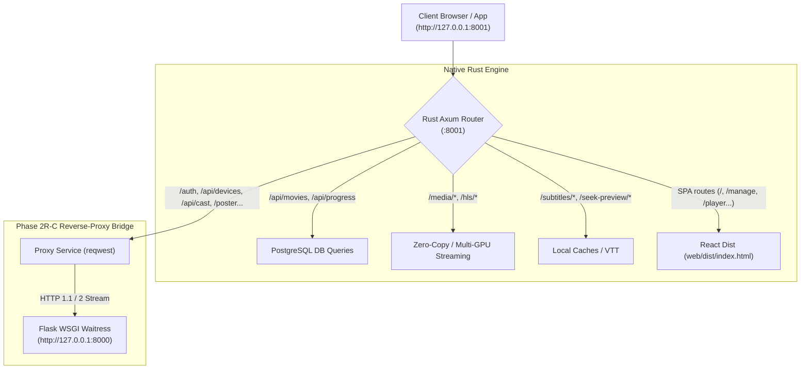

# Implementation Plan: Phase 2R-C — Reverse-Proxy Bridge for Unmigrated Endpoints

**Status:** Proposed — Awaiting User Approval  
**Repository:** `anis7t/media-server`  
**Governing Document:** [`docs/FLASK_RUST_REACT_POSTGRES_MIGRATION_ROADMAP.md`](FLASK_RUST_REACT_POSTGRES_MIGRATION_ROADMAP.md) §Phase 2 & §Phase 5  
**Preceding Deliverables:** Phase 2R-A (Dual-Origin Vite Proxy), Phase 2R-B (Rust Static SPA Server & Fallback), Rust Windows Service (`MediaServerRust`)  
**Target:** Make `http://127.0.0.1:8001` a completely self-sufficient portal by transparently forwarding unmigrated endpoints to Flask (`:8000`).  
**Date:** October 15, 2026

---

## 1. Executive Summary & Problem Statement

In **Phase 2R-B**, the native Rust server on `http://127.0.0.1:8001` began directly serving the compiled React Single Page Application (`web/dist/`) alongside high-speed native media streaming and movie APIs.

However, when browsing `http://127.0.0.1:8001`:
- Movie posters (`/tmdb-poster/*`, `/poster/*`)
- Device telemetry & management (`/api/devices/*`)
- Google OAuth login & session management (`/auth/*`, `/api/auth/*`)
- LAN casting to Chromecast / DLNA (`/api/cast/*`)
- Storage pools & retention policies (`/api/storage/*`, `/api/admin/*`)
- Manual library scans (`/api/scan`)

currently return `404 Not Found` because these features remain implemented in Python Flask (`http://127.0.0.1:8000`).

**Phase 2R-C** closes this loop by introducing a high-performance **Reverse-Proxy Bridge** in Rust Axum using `reqwest`:
Any client accessing `http://127.0.0.1:8001` has its unmigrated requests transparently streamed to Flask on `:8000`, returning headers, status codes, and bodies without buffering or modification. Once delivered, port `8001` becomes **100% feature-complete**.

---

## 2. Architecture & Data Flow



---

## 3. Detailed Technical Design

### A. Dependencies (`rust/Cargo.toml`)
Promote `reqwest` from `[dev-dependencies]` to `[dependencies]`:
```toml
reqwest = { version = "0.12", features = ["json", "stream"] }
```
`reqwest` is already in the cargo cache; adding `stream` enables zero-copy chunked body streaming between Axum and Waitress.

### B. Configuration (`rust/src/config.rs`)
Add `flask_origin: String` to `AppConfig`:
- Variable: `FLASK_ORIGIN` or `MEDIA_SERVER_FLASK_ORIGIN`
- Default: `"http://127.0.0.1:8000"`

### C. Proxy Service Implementation (`rust/src/routes/proxy.rs`)
Implement `ProxyState` and `proxy_handler`:
1. **Target Construction:** Build upstream URI:
   ```rust
   let path_and_query = uri.path_and_query().map(|pq| pq.as_str()).unwrap_or(uri.path());
   let target_url = format!("{}{}", state.flask_origin, path_and_query);
   ```
2. **Method & Header Forwarding:**
   - Forwards exact HTTP method (`GET`, `POST`, `PUT`, `DELETE`, `PATCH`, `HEAD`, `OPTIONS`).
   - Copies incoming client headers (`Cookie`, `Authorization`, `X-Admin-Pin`, `Content-Type`, `Sec-CH-UA-*`, `User-Agent`, `Accept`).
   - Strips hop-by-hop headers (`Connection`, `Keep-Alive`, `Proxy-Authenticate`, `Proxy-Authorization`, `TE`, `Trailers`, `Transfer-Encoding`, `Upgrade`).
   - Adjusts `Host` header to upstream target.
3. **Body Streaming:**
   - Streams incoming request body into upstream request:
     `client_req.body(reqwest::Body::wrap_stream(req.into_body().into_data_stream()))`
4. **Response Translation:**
   - Translates upstream HTTP status code (`200`, `302`, `401`, `403`, `500`).
   - Copies upstream headers to the downstream Axum response (`Content-Type`, `Set-Cookie`, `Location`, `Cache-Control`, `Content-Disposition`).
   - Streams upstream response body using `axum::body::Body::from_stream(upstream_res.bytes_stream())`.
5. **Resiliency & Fault Tolerance:**
   - If upstream Flask is down or unreachable, returns `502 Bad Gateway` JSON:
     ```json
     {
       "error": "Bad Gateway",
       "message": "Failed to connect to upstream Flask backend",
       "target": "http://127.0.0.1:8000"
     }
     ```

### D. Route Registration (`rust/src/lib.rs`)
Mount the proxy routes before SPA fallback:
```rust
let proxy_routes = Router::new()
    .route("/auth", any(proxy_handler))
    .route("/auth/{*path}", any(proxy_handler))
    .route("/api/auth/{*path}", any(proxy_handler))
    .route("/api/devices", any(proxy_handler))
    .route("/api/devices/{*path}", any(proxy_handler))
    .route("/api/cast", any(proxy_handler))
    .route("/api/cast/{*path}", any(proxy_handler))
    .route("/tmdb-poster/{*path}", any(proxy_handler))
    .route("/tmdb-backdrop/{*path}", any(proxy_handler))
    .route("/poster/{*path}", any(proxy_handler))
    .route("/api/admin/{*path}", any(proxy_handler))
    .route("/api/storage/{*path}", any(proxy_handler))
    .route("/api/scan", any(proxy_handler))
    .route("/api/media-info/{*path}", any(proxy_handler))
    .with_state(proxy_state);
```

---

## 4. Verification Plan

### Automated Unit & Integration Tests:
1. **`rust/tests/proxy_bridge_test.rs`**:
   - Spawns a mock HTTP server / test router simulating Flask.
   - Test 1: `GET /poster/test.jpg` -> forwarded to upstream, receives upstream 200 with image bytes.
   - Test 2: `POST /api/devices/heartbeat` with JSON body and custom headers (`X-Admin-Pin`) -> upstream receives body & headers verbatim.
   - Test 3: Cookie & Redirect handling (`/auth/login` returning 302 with `Location` & `Set-Cookie`) -> client receives exact 302 and `Set-Cookie`.
   - Test 4: Upstream unreachable (offline port) -> client receives clean `502 Bad Gateway` JSON.
   - Test 5: Verify all existing 52 Rust tests continue to pass (`.\scripts\cargo.bat test`).

### Live Service Verification:
1. Recompile and restart `MediaServerRust` via `.\scripts\restart_rust_service.bat`.
2. Probe live ported endpoints on `http://127.0.0.1:8001`:
   - `http://127.0.0.1:8001/api/devices/active` -> returns 200 JSON from Flask.
   - `http://127.0.0.1:8001/api/storage/status` -> returns 200 JSON from Flask.
   - `http://127.0.0.1:8001/api/movies` -> returns 200 JSON natively from Rust.
   - `http://127.0.0.1:8001/` -> renders React SPA with real movie posters loaded via proxy!

---

## 5. Risk Assessment & Safety Guardrails

- **Zero-Disruption to Flask:** Flask on port `8000` and the Cloudflare tunnel continue serving production users undisturbed.
- **Header Security:** Sensitive headers like `X-Admin-Pin` and session cookies are forwarded without truncation or logging.
- **Resource Limits:** `reqwest::Client` uses persistent connection pooling with bounded idle sockets to avoid connection leaks under high concurrency.
