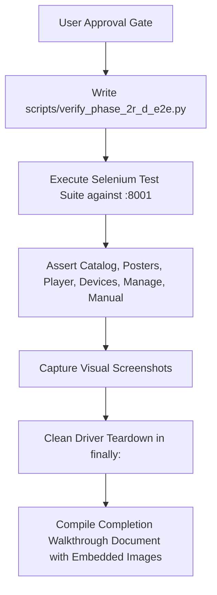

# Implementation Plan: Phase 2R-D — End-to-End Live Browser & Integration Verification

**Status:** Proposed — Awaiting User Approval  
**Repository:** `anis7t/media-server`  
**Governing Document:** [`docs/FLASK_RUST_REACT_POSTGRES_MIGRATION_ROADMAP.md`](FLASK_RUST_REACT_POSTGRES_MIGRATION_ROADMAP.md) §Phase 2 & §Phase 5  
**Preceding Deliverables:** Phase 2R-A (Dual-Origin Vite Proxy), Phase 2R-B (Rust Static SPA Server), Phase 2R-C (Reverse-Proxy Bridge), `MediaServerRust` Windows Service  
**Target:** Execute automated autonomous Selenium browser tests across all routes on `http://127.0.0.1:8001` to verify end-to-end functionality.  
**Date:** October 15, 2026

---

## 1. Objectives

Verify that the unified native Rust server on `http://127.0.0.1:8001`:
1. Serves the modern React Single Page Application with client-side routing on all URLs (`/`, `/movie/:filename`, `/player/:filename`, `/devices`, `/manage`, `/manual`).
2. Natively queries PostgreSQL for movie catalog data (`/api/movies`).
3. Streams video (`/media/*`) and HLS (`/hls/*`) directly from Rust with zero-copy range streaming.
4. Transparently proxies movie posters (`/tmdb-poster/*`, `/poster/*`), device telemetry (`/api/devices/*`), and storage settings (`/api/storage/*`) from Flask Waitress on `:8000`.
5. Captures visual screenshots of all major pages and stores them as artifacts.

---

## 2. Test Matrix & Route Verification

| Suite | Target Route | Core Validations | Screenshot Artifact |
| :--- | :--- | :--- | :--- |
| **1. Library Catalog** | `http://127.0.0.1:8001/?intro=off` | React `#root` mounts, movie cards render, TMDb poster images load with `naturalWidth > 0` via proxy bridge. | `phase_2r_d_home_catalog.png` |
| **2. Movie Details** | `http://127.0.0.1:8001/movie/2001...` | Deep client-side link resolution, title, backdrop, runtime badge, audio/video specs, play button. | `phase_2r_d_movie_details.png` |
| **3. Cinema Player** | `http://127.0.0.1:8001/player/2001...` | `<video>` element loads with native stream source (`/media/...`), readyState advances, player controls overlay visible. | `phase_2r_d_player.png` |
| **4. Device Dashboard** | `http://127.0.0.1:8001/devices` | Client-side routing to `/devices`, connected devices table renders data proxied from Flask (`/api/devices`). | `phase_2r_d_devices.png` |
| **5. Storage Pool** | `http://127.0.0.1:8001/manage` | Storage telemetry, retention policy dropdown loaded via proxy (`/api/storage/settings`), admin PIN gate. | `phase_2r_d_manage.png` |
| **6. User Manual** | `http://127.0.0.1:8001/manual` | Client-side routing to `/manual`, keyboard shortcuts, multi-GPU guide, offline manual rendered cleanly. | `phase_2r_d_manual.png` |

---

## 3. Automation Architecture & Guardrails

- **Script:** [`scripts/verify_phase_2r_d_e2e.py`](file:///e:/MediaServer/scripts/verify_phase_2r_d_e2e.py)
- **Headless Chrome:** Runs using `selenium.webdriver.Chrome` with options `--headless=new`, `--window-size=1600,1000`, `--disable-gpu`.
- **Strict Process Safety:** Wrapped in `try ... finally: driver.quit()` to guarantee zero lingering browser tasks.
- **Bounded Polling:** Explicit waits capped at 15s using `WebDriverWait` and `expected_conditions`.
- **Artifact Embeds:** Visual screenshots saved to `_shots/` and copied to the IDE artifact directory for inline walkthrough rendering.

---

## 4. Execution Steps

---

Please confirm if you would like me to proceed with executing **Phase 2R-D**.
