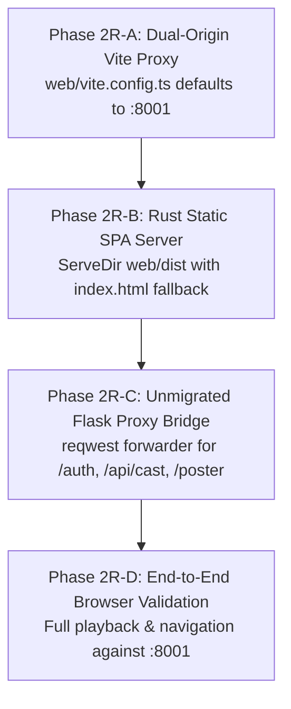

# Implementation Plan: Phase 2R — React Frontend & Rust Engine Integration

> **Document Type:** Sliced Integration Implementation Plan  
> **Repository:** `anis7t/media-server`  
> **Branch:** `feat/rust-api-foundation`  
> **Governing Document:** [`docs/FLASK_RUST_REACT_POSTGRES_MIGRATION_ROADMAP.md`](FLASK_RUST_REACT_POSTGRES_MIGRATION_ROADMAP.md) §Phase 2 & §Phase 5  
> **Preceding Deliverables:** Phase 2 React Frontend (`web/`, 172 tests), Phase 4 Rust API Foundation, Phase 5 Rust Media & Streaming Engine (47 tests)  
> **Status:** 📋 **AWAITING USER APPROVAL**

---

## 1. Executive Summary & Architectural Goal

While the React frontend codebase (`web/`) is completely written and verified (172/172 passing tests), it was originally configured to proxy to the legacy Python Flask/Waitress backend (`127.0.0.1:8000`). Concurrently, the newly delivered native Rust backend (`rust/`, 47/47 passing tests) is listening on `127.0.0.1:8001` but only exposes API and media routes, leaving production SPA assets unserved.

**Phase 2R (React-Rust Integration)** connects the two systems so that:
1. **Development**: The Vite dev server (`http://localhost:5173`) proxies all media and API requests to the native Rust engine on `http://127.0.0.1:8001`, falling back to Flask for unmigrated endpoints.
2. **Production / Standalone**: The Rust Axum server on `http://127.0.0.1:8001` directly serves the compiled React SPA (`web/dist/`) with SPA fallback routing, and transparently proxies unmigrated routes to Flask (`127.0.0.1:8000`).
3. Users visiting `http://127.0.0.1:8001` experience the full modern React UI powered directly by the high-throughput (510+ Mbps) Rust engine.

---

## 2. Phased Breakdown



---

### Phase 2R-A: Dual-Origin Vite Proxy & Dev Environment Wiring

**Objective**: Configure `web/vite.config.ts` to seamlessly divide development traffic between the Rust engine (primary) and Flask (unmigrated).

#### Changes:
- Update `web/vite.config.ts`:
  - Define `RUST_ORIGIN = process.env.RUST_API_ORIGIN ?? 'http://127.0.0.1:8001'`
  - Define `FLASK_ORIGIN = process.env.MEDIA_SERVER_ORIGIN ?? 'http://127.0.0.1:8000'`
  - **Routes proxied to Rust (`RUST_ORIGIN`)**:
    - `/api/movies`, `/api/movie`
    - `/api/progress`
    - `/api/system-status`
    - `/api/seek-preview-meta`
    - `/api/subtitles`, `/api/upload-subtitle`
    - `/api/transcode-status`
    - `/media`
    - `/hls`
    - `/seek-preview`
    - `/preview-vtt`
    - `/subtitles`
  - **Routes proxied to Flask (`FLASK_ORIGIN`)**:
    - `/auth` (Google OAuth login)
    - `/api/cast` (LAN Google Cast & DLNA)
    - `/api/devices` (Device management)
    - `/tmdb-poster`, `/tmdb-backdrop`, `/poster` (Artwork caching)
    - `/api/admin`, `/api/storage` (Storage policies & audit)

---

### Phase 2R-B: Static SPA Serving & Fallback Routing in Rust Axum

**Objective**: Enable the native Rust executable (`media-server-api.exe`) to serve the compiled React SPA in production without requiring Node.js or Vite.

#### Changes:
- **`rust/Cargo.toml`**:
  - Add `tower-http = { version = "0.6", features = ["fs", "cors", "trace"] }` (`fs` feature enables `ServeDir` and `ServeFile`).
- **`rust/src/lib.rs`**:
  - Check if `web/dist` exists.
  - Mount SPA fallback routing:
    ```rust
    let serve_dir = ServeDir::new("web/dist")
        .not_found_service(ServeFile::new("web/dist/index.html"));
    ```
  - Ensure API and media routes have precedence over the static SPA fallback:
    ```rust
    Router::new()
        .merge(api_routes)
        .merge(media_routes)
        .fallback_service(serve_dir)
    ```
  - Set appropriate caching headers:
    - `index.html`: `Cache-Control: no-cache, must-revalidate`
    - Assets (`/assets/*`): `Cache-Control: public, max-age=31536000, immutable`

---

### Phase 2R-C: Reverse-Proxy Bridge for Unmigrated Endpoints in Rust

**Objective**: Allow Rust to act as the single authoritative server on port 8001 by forwarding unmigrated requests to Flask (`127.0.0.1:8000`).

#### Changes:
- **`rust/src/routes/proxy.rs`**:
  - Implement a fallback forwarder for:
    - `/auth/{*path}`
    - `/tmdb-poster/{*path}`, `/tmdb-backdrop/{*path}`, `/poster/{*path}`
    - `/api/cast/{*path}`
    - `/api/devices/{*path}`
  - Uses `reqwest::Client` to stream request body, method, headers, and query parameters to `http://127.0.0.1:8000`.
  - Streams the Flask response headers and body back to the client.
- **`rust/src/lib.rs`**:
  - Mount proxy routes so React never experiences broken images or missing OAuth redirects when loaded directly from `http://127.0.0.1:8001`.

---

### Phase 2R-D: End-to-End Browser Verification & Playback Testing

**Objective**: Verify the entire integrated stack in real browsers.

#### Verification Steps:
1. Compile fresh production React bundle: `npm run build` in `web/`.
2. Run full Rust test suite: `.\scripts\cargo.bat test --manifest-path rust\Cargo.toml`.
3. Launch Rust server on port 8001:
   - Navigate to `http://127.0.0.1:8001/` in browser.
   - Verify React SPA loads instantly.
   - Verify Movie Library renders cards with poster artwork.
   - Click a movie (e.g. *2001: A Space Odyssey* or *Spiderman Brand New Day*).
   - Test Direct Play MP4 streaming and HLS playback.
   - Scrub seekbar and verify live hover frame thumbnails.
   - Test subtitle toggle and offset adjust.
   - Verify watch progress updates in PostgreSQL.

---

## 3. Deliverables Summary

| Slice | Focus | Target Files |
|---|---|---|
| **Phase 2R-A** | Dev Vite Proxy | `web/vite.config.ts` |
| **Phase 2R-B** | Axum SPA Serving | `rust/Cargo.toml`, `rust/src/lib.rs` |
| **Phase 2R-C** | Unmigrated Flask Proxy Bridge | `rust/src/routes/proxy.rs`, `rust/src/lib.rs` |
| **Phase 2R-D** | E2E Browser Testing | `web/dist/`, Browser verification, Walkthrough documentation |
