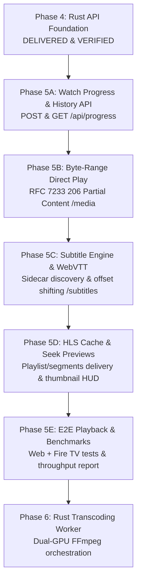

# Implementation Plan: Phase 5 Slices — Rust Media Playback & Streaming

> **Document Type:** Migration Phase Implementation Plan  
> **Repository:** `anis7t/media-server`  
> **Branch:** `feat/rust-api-foundation`  
> **Governing Document:** [`docs/FLASK_RUST_REACT_POSTGRES_MIGRATION_ROADMAP.md`](FLASK_RUST_REACT_POSTGRES_MIGRATION_ROADMAP.md) §Phase 5  
> **Depends On:** Phase 4 Rust API Foundation ([`docs/PHASE_4_RUST_API_WALKTHROUGH.md`](PHASE_4_RUST_API_WALKTHROUGH.md))  
> **Status:** 📋 **AWAITING USER APPROVAL**

---

## 1. Goal Description & Scope Breakdown

Phase 5 of the Media Server modernization roadmap migrates media playback, streaming, watch progress, and subtitle delivery to the Rust Axum backend. To minimize risk, preserve strict behavioral parity, and allow independent testing and approval at each milestone, Phase 5 is divided into **5 sequential sub-phases**:

1. **Phase 5A: Playback Watch Progress & History API (`/api/progress`)**
2. **Phase 5B: Multi-Root Safe Path Resolution & RFC 7233 Byte-Range Direct Play (`/media/{*path}`)**
3. **Phase 5C: Subtitle Delivery Engine & Dynamic WebVTT Shifting (`/subtitles/{*path}` & `/api/subtitles/{*filename}`)**
4. **Phase 5D: HLS Playlist/Segment Delivery & Seek Hover Previews (`/hls/{*path}` & `/seek-preview/{*path}`)**
5. **Phase 5E: End-to-End Multi-Client Playback Validation & Concurrency Benchmarking**

---

## 2. User Review & Architectural Invariants

> [!IMPORTANT]
> **Orchestration Boundary (Phase 5 vs Phase 6)**:
> In Phase 5, Rust handles **all delivery** of raw media files, HLS cache playlists/segments, seek previews, subtitles, and progress tracking. Dynamic FFmpeg multi-GPU transcode job spawning and queue management remain with Flask until **Phase 6 (Rust Transcoding Worker)** per [`docs/FLASK_RUST_REACT_POSTGRES_MIGRATION_ROADMAP.md`](FLASK_RUST_REACT_POSTGRES_MIGRATION_ROADMAP.md). This preserves dual-GPU stability on the AMD RX 560X and Vega 8 hardware while allowing direct streaming to achieve Rust speed immediately.

> [!NOTE]
> **Sequential Sub-Phase Approvals**:
> Each sub-phase (5A → 5B → 5C → 5D → 5E) will be implemented, verified with automated tests, and presented with a walkthrough document for approval before proceeding to the next.

---

## 3. Sub-Phase Architecture & Deliverables



---

### Phase 5A: Playback Watch Progress & History API

**Objective**: Asynchronous watch progress persistence and querying against PostgreSQL 18.4 (`media_server`).

#### Key Features:
- `GET /api/progress?filename={filename}`:
  - Extracts `x-device-id` header (falling back to query parameter or anonymous).
  - Queries `device_watch_history` by `(device_id, filename)`; falls back to global `progress` table.
  - Returns `{"position": 124.5, "duration": 5420.0}`.
- `POST /api/progress`:
  - Request body: `{"filename": "Avatar.mp4", "position": 125.0, "duration": 5420.0}`.
  - Validates `position >= 0` and clamps `position <= duration`.
  - Executes upsert into `progress` (`ON CONFLICT (filename) DO UPDATE SET position = ..., duration = ..., updated_at = CURRENT_TIMESTAMP`).
  - Executes upsert into `device_watch_history` (`ON CONFLICT (device_id, filename) DO UPDATE SET position = ..., duration = ..., updated_at = CURRENT_TIMESTAMP`).
  - Returns `{"success": true}`.

#### Proposed Changes:
- **[NEW]** `rust/src/routes/progress.rs`: Axum handlers for `GET` and `POST /api/progress`.
- **[NEW]** `rust/src/services/progress_service.rs`: Database queries and upserts with SQLx.
- **[MODIFY]** `rust/src/lib.rs`: Mount `/api/progress` into router.
- **[NEW]** `rust/tests/progress_contracts_test.rs`: Contract tests verifying GET/POST progress, clamping, and multi-device isolation.

---

### Phase 5B: Multi-Root Path Resolution & RFC 7233 Byte-Range Direct Play

**Objective**: High-throughput, zero-copy direct streaming for progressive MP4, M4V, and WebM files.

#### Key Features:
- Multi-Root Path Resolution (`services/path_resolver.rs`):
  - Resolves across `D:\Flicks` (mass storage), `D:\Flicks\.archive` (archive mirror), and `E:\MediaServer`.
  - Enforces strict canonical containment checks (`canonical_path.starts_with(root)`), blocking directory traversal (`..`), null bytes (`\0`), and path escapes.
- RFC 7233 Byte-Range Engine (`services/range_service.rs`):
  - Parses standard HTTP `Range` headers:
    - Explicit range: `bytes=0-1048575` (first 1 MB)
    - Open-ended range: `bytes=1048576-` (from 1 MB to EOF)
    - Suffix range: `bytes=-524288` (last 512 KB)
  - Validates bounds against file length `stat.len()`.
  - Generates HTTP `206 Partial Content` with:
    - `Content-Range: bytes {start}-{end}/{total}`
    - `Content-Length: {end - start + 1}`
    - `Accept-Ranges: bytes`
    - `ETag` and `Last-Modified` headers
  - Handles unsatisfiable ranges (`Range: bytes=999999999-`) with HTTP `416 Range Not Satisfiable` and `Content-Range: bytes */{total}`.
  - Handles requests without `Range` header with HTTP `200 OK` and `Accept-Ranges: bytes`.
- Streaming I/O:
  - Uses `tokio::fs::File`, performs non-blocking `seek(SeekFrom::Start(start))`, and wraps with `tokio_util::io::ReaderStream` capped to requested length. Zero whole-file memory allocation.
- Receiver & Second-Screen Headers:
  - Applies CORS (`Access-Control-Allow-Origin: *`, `Cross-Origin-Resource-Policy: cross-origin`) and DLNA headers (`contentFeatures.dlna.org`, `transferMode.dlna.org: Streaming`).

#### Proposed Changes:
- **[MODIFY]** `rust/Cargo.toml`: Add `tokio-util = { version = "0.7", features = ["io"] }`, `mime_guess = "2.0"`.
- **[NEW]** `rust/src/services/path_resolver.rs`: Multi-root resolution and path sanitizer.
- **[NEW]** `rust/src/services/range_service.rs`: RFC 7233 range parser and streamed body builder.
- **[NEW]** `rust/src/routes/media.rs`: Axum handler for `GET /media/{*path}` and `HEAD /media/{*path}`.
- **[MODIFY]** `rust/src/lib.rs`: Mount `/media` route.
- **[NEW]** `rust/tests/streaming_range_test.rs`: Comprehensive test suite verifying 200, 206, 416, and DLNA headers.

---

### Phase 5C: Subtitle Delivery Engine & Dynamic WebVTT Shifting

**Objective**: Sidecar subtitle resolution, SRT-to-WebVTT parsing, and dynamic timing offset adjustments.

#### Key Features:
- Sidecar Subtitle Resolution:
  - Discovers `.srt` and `.vtt` sidecars alongside video in `D:\Flicks` and cross-volume mirrors (`D:\Flicks\.archive`).
- Dynamic WebVTT Conversion:
  - On-the-fly conversion of SubRip (`.srt`) to WebVTT (`.vtt`):
    - Appends `WEBVTT\n\n` header.
    - Replaces comma `,` milliseconds delimiter with period `.` (`00:01:23,456` → `00:01:23.456`).
- Timestamp Offset Shifting:
  - Supports query parameter `?offset=<seconds>` (e.g. `?offset=0.25` or `?offset=-0.5`).
  - Adjusts start and end timestamps of all cue blocks monotonically, clamping to `00:00:00.000`.
- Track Catalog API (`GET /api/subtitles/{filename}`):
  - Returns JSON listing of available sidecar and cached tracks with detected language codes and labels.
- Scoped CORS Headers:
  - Full CORS headers on `/subtitles/*` enabling Google Cast CAF receiver loading.

#### Proposed Changes:
- **[NEW]** `rust/src/services/subtitle_service.rs`: Subtitle parser, converter, and cue shifter.
- **[NEW]** `rust/src/routes/subtitles.rs`: Handlers for `GET /subtitles/{*path}` and `GET /api/subtitles/{*filename}`.
- **[MODIFY]** `rust/src/lib.rs`: Mount subtitle routes.
- **[NEW]** `rust/tests/subtitles_test.rs`: Unit and contract tests for WebVTT conversion, offset shifting, and CORS.

---

### Phase 5D: HLS Playlist/Segment Delivery & Seek Hover Previews

**Objective**: Low-latency static cache delivery for HLS video streams and seekbar frame thumbnails.

#### Key Features:
- HLS Delivery (`/hls/{*path}`):
  - Master playlist delivery (`/hls/{filename}/playlist.m3u8`):
    - MIME type: `application/vnd.apple.mpegurl`
    - `Cache-Control: no-cache, max-age=0`
    - CORS headers (`Access-Control-Allow-Origin: *`)
  - Chunk segment delivery (`/hls/{filename}/{segment}`):
    - Supports `segment_\d{6}.ts`, `segment_\d{6}.m4s`, and `init.mp4`.
    - MIME type: `video/mp2t` or `video/mp4`
    - `Cache-Control: public, max-age=3600`
- Seek Hover Previews:
  - Metadata route: `GET /api/seek-preview-meta/{*filename}` returning `duration`, `interval`, `count`, `base_url`.
  - Thumbnail delivery: `GET /seek-preview/{filename}/thumb_{index}.jpg` serving cached frames from `E:\MediaServer\cache\previews`.

#### Proposed Changes:
- **[NEW]** `rust/src/routes/hls.rs`: HLS playlist and segment delivery handlers.
- **[NEW]** `rust/src/routes/previews.rs`: Seek preview metadata and thumbnail delivery handlers.
- **[MODIFY]** `rust/src/lib.rs`: Mount `/hls` and `/seek-preview` routes.
- **[NEW]** `rust/tests/hls_and_preview_test.rs`: Tests asserting HLS and thumbnail delivery and MIME types.

---

### Phase 5E: End-to-End Playback Validation & Concurrency Benchmarking

**Objective**: Multi-client regression verification and performance benchmarking.

#### Key Features:
- End-to-End Playback Testing:
  - Web frontend playback (RFC 7233 byte-range seek, pause, resume, progress persistence).
  - Android/Fire TV client compatibility testing against Rust streaming endpoints.
- Streaming Throughput & Concurrency Benchmark:
  - Benchmark Rust Axum streaming on port 8001 vs Flask Waitress on port 8000 across concurrent direct streams (1 to 16 workers).
  - Document throughput (Mbps), latency to first chunk (TTFB), and CPU/RAM RSS overhead.
- Final Phase 5 Documentation:
  - Authored `docs/PHASE_5_RUST_STREAMING_WALKTHROUGH.md`.
  - Updated `docs/MIGRATION_STATUS.md`.

---

## 4. Verification Plan

### Automated Tests
```powershell
# Phase 5A
.\scripts\cargo.bat test --test progress_contracts_test

# Phase 5B
.\scripts\cargo.bat test --test streaming_range_test

# Phase 5C
.\scripts\cargo.bat test --test subtitles_test

# Phase 5D
.\scripts\cargo.bat test --test hls_and_preview_test

# Full Phase 5 Suite
.\scripts\cargo.bat test --manifest-path rust\Cargo.toml
.\scripts\cargo.bat check --manifest-path rust\Cargo.toml
```

### Manual Verification
- Stream a progressive MP4 movie (*Oculus*, *Spider-Man*, or *Ghost in the Cell*) via browser on port 8001.
- Verify instant scrubbing to 25%, 50%, and 75% without playback stalls.
- Verify subtitles render and synchronize accurately.
- Verify watch progress updates in PostgreSQL database.
