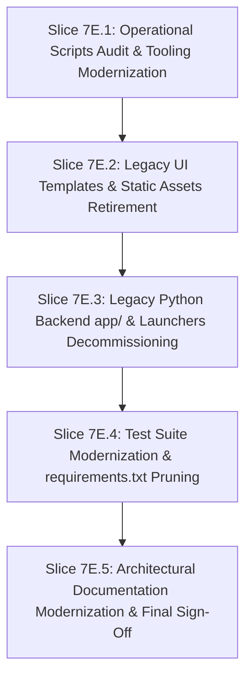

# Implementation Plan — Phase 7 Backlog: Slice 7E (Legacy Flask Retirement & Final Modernization Sign-Off)

## 1. Executive Summary & Context
With **Phase 9 (Client Media Capabilities, Offline Pre-Transcode Architecture & 100% Gating)** and **Active Issues Slices A–D** delivered, verified, and committed, the production server is operating exclusively on:
- **Rust / Axum (`MediaServerRust`) on port 8000** as an NSSM Windows service.
- **PostgreSQL 18.4 (`MediaServerPG`) on port 5432** as the canonical database.
- **React SPA (`web/dist/`)** served directly by Axum's `SpaFallbackService`.
- **Cloudflare Tunnel (`media.anisparvez.in`)** mapped directly to `127.0.0.1:8000`.

Per [AGENTS.md §0.2](file:///e:/MediaServer/AGENTS.md#L30-L50), Flask and Waitress are deprecated and must be retired. To ensure safe, incremental execution with zero risk to the live production server or operational tooling, **Slice 7E is partitioned into 5 sequential, independently verifiable sub-slices (7E.1 through 7E.5)**.

---

## 2. Sub-Slice Division Structure

---

### Sub-Slice 7E.1: Operational Scripts Audit & Tooling Modernization
**Goal**: Safeguard and isolate active operational tools while removing obsolete Flask-era scripts from `scripts/`.
- **Actions**:
  1. Audit all scripts in `scripts/` to confirm zero dependencies on `app/`.
  2. Verify and preserve active operational scripts:
     - `scripts/probe_android_api.py` (Android client API contract probe)
     - `scripts/probe_phase_8_contracts.py` (Phase 8 fMP4 adaptive streaming probe)
     - `scripts/backup_postgres.bat` & `scripts/backup_postgres.ps1` (native PostgreSQL backup via `pg_dump`)
     - `scripts/restart_rust_service.bat` & `scripts/restart_rust_service.ps1`
     - `scripts/restart_service.bat` (delegates to `restart_rust_service.ps1`)
     - `scripts/install_rust_service.bat` & `scripts/install_rust_service.ps1`
     - `scripts/uninstall_rust_service.bat` & `scripts/uninstall_rust_service.ps1`
     - `scripts/rust_service_status.ps1` & `scripts/service_status.ps1`
     - `scripts/publish_update.py` & `scripts/release_android.py` (release automation)
     - `scripts/run_flutter_tests.ps1`
  3. Decommission obsolete Flask-era scripts in `scripts/`:
     - Old service scripts: `install_service.*`, `uninstall_service.*`, `install_watchdog.*`, `service_watchdog.*`, `uninstall_watchdog.*`
     - One-off migration scripts: `cutover_port_8000.*`, `migrate_sqlite_to_postgres.py`
     - Obsolete SQLite tools: `backup_database.py`, `restore_database.py`, `backup_database.bat`
     - Historical Flask HLS/transcode probe scripts (`hls_completeness_report.py`, `hls_content_gap_inventory.py`, `hls_frame_audit.py`, `hls_gop_matrix.py`, `hls_layout_migration_check.py`, `hls_per_gpu_segments.py`, `hls_pipeline_regression.py`, `hls_restore_endlist.py`, `final_verification_battery.py`, `benchmark_streaming.py`, `benchmark_real_movie_transcode.py`, `snapshot_live_data.py`, `verify_rust_transcode_live.py`, `verify_rust_spa_live.py`, `verify_phase_2r_d_e2e.py`, `verify_cast_live.py`)
- **Exit Gate 7E.1**:
  - Run `python scripts/probe_android_api.py` (22/22 OK).
  - Run `python scripts/probe_phase_8_contracts.py` (OK).
  - Run `powershell -File scripts/rust_service_status.ps1` (MediaServerRust running on port 8000).

---

### Sub-Slice 7E.2: Legacy UI Templates & Static Asset Retirement
**Goal**: Remove deprecated Jinja HTML templates and legacy CSS/JS files that were superseded by the React SPA.
- **Actions**:
  1. Remove `templates/` directory (`details.html`, `devices.html`, `download.html`, `error.html`, `intro-overlay.html`, `library.html`, `manage.html`, `manual.html`, `player.html`).
  2. Remove `static/` directory (`static/css/`, `static/js/`, `static/vendor/`).
  3. Remove one-off legacy diagnosis scripts from project root (`tmdb_test.py`, `tmdb_diag.py`, `tmdb_details_test.py`).
- **Exit Gate 7E.2**:
  - Run `npm run test:run` in `web/` (212/212 Vitest tests pass).
  - Run `npm run build` in `web/` (`tsc -b` clean, Vite bundle clean).
  - Verify `GET http://127.0.0.1:8000/` returns the modern React SPA shell.

---

### Sub-Slice 7E.3: Legacy Python Backend (`app/`) & Launchers Decommissioning
**Goal**: Decommission the deprecated Flask codebase and obsolete root entry points.
- **Actions**:
  1. Remove root launcher scripts:
     - `app.py`
     - `run_production.py`
     - `gunicorn.conf.py`
     - `scanner.py` & `posters.py` (superseded by native Rust background scanner `scan_service.rs` and `tmdb_artwork.rs`)
     - `server.sh`
  2. Remove deprecated `app/` directory:
     - `app/__init__.py`
     - `app/config.py`
     - `app/db.py`
     - `app/routes/` (`admin.py`, `api.py`, `cast.py`, `devices.py`, `media.py`, `pages.py`, `subtitles.py`, `upload.py`)
     - `app/services/` (all 15 Python services)
     - `app/utils/` (`auth.py`, `filesystem.py`, `formatting.py`, `subtitles.py`)
- **Exit Gate 7E.3**:
  - Verify zero remaining files in `app/`.
  - Run `cargo check` and `cargo test` in `rust/` (all 15 test suites, 119/119 pass).
  - Verify live Rust Axum endpoints via `probe_android_api.py` and `probe_phase_8_contracts.py`.

---

### Sub-Slice 7E.4: Test Suite Modernization & Python Dependency Pruning (`requirements.txt`)
**Goal**: Retire obsolete Flask internal unit tests and prune `requirements.txt` to operational tooling essentials.
- **Actions**:
  1. Remove obsolete Python tests in `tests/test_*.py` and `tests/conftest.py` that tested Flask internal functions.
  2. Preserve `tests/load/` benchmark records.
  3. Prune `requirements.txt`:
     - Remove: `Flask`, `waitress`, `gunicorn`, `WMI`, `pywin32`.
     - Retain: `psycopg[binary]>=3.2.0,<4`, `psycopg-pool>=3.2.0,<4`, `requests>=2.31,<3`, `python-dotenv>=1.0,<2`.
- **Exit Gate 7E.4**:
  - `requirements.txt` contains zero references to web frameworks or WSGI servers.
  - Operational Python scripts execute without missing dependency errors.
  - Rust test suite (119/119) and Web Vitest suite (212/212) remain 100% green.

---

### Sub-Slice 7E.5: Architectural Documentation Modernization & Final Sign-Off
**Goal**: Update all repository guidelines, READMEs, and roadmap trackers to reflect 100% native Rust + React + PostgreSQL architecture.
- **Actions**:
  1. Update `AGENTS.md`:
     - Update Project Identity to 100% Rust / Axum + React SPA + PostgreSQL 18.
     - Remove obsolete references to Flask, Waitress, Jinja invariants, and hybrid bridging.
     - Update Service Restart instructions to reference `scripts/restart_service.bat` (`MediaServerRust`).
  2. Update `README.md`:
     - Update architecture diagrams, technology stack, directory structure, and development commands.
  3. Update `docs/MIGRATION_STATUS.md` and `docs/PROJECT_STATUS.md`:
     - Mark Phase 7 Slice 7E as COMPLETE.
     - Mark the full Flask-to-Rust/React/PostgreSQL migration 100% DELIVERED & VERIFIED.
  4. Author comprehensive walkthrough document `docs/SLICE_7E_WALKTHROUGH.md`.
- **Exit Gate 7E.5**:
  - Full test battery verification:
    - 119/119 Rust tests pass across 15 suites.
    - 212/212 Vitest tests pass across 30 suites.
    - `tsc -b` and `vite build` clean.
    - 22/22 Android client contracts pass.
    - Phase 8 adaptive streaming contract probe passes.
  - All documentation updated and aligned.

---

## 3. Exit Criteria Summary Table

| Sub-Slice | Key Deliverables | Verification Gate |
|---|---|---|
| **7E.1** | Clean `scripts/` directory with only operational tooling | `probe_android_api.py` (22/22) + `probe_phase_8_contracts.py` + `rust_service_status.ps1` |
| **7E.2** | Decommissioned `templates/`, `static/`, and root diagnostics | `npm run test:run` (212/212) + `npm run build` + live SPA curl |
| **7E.3** | Decommissioned `app/` and root Python launchers | `cargo test` (119/119) + live API probes |
| **7E.4** | Cleaned `tests/` and pruned `requirements.txt` | Pruned dependencies probe test + Rust 119/119 + Web 212/212 |
| **7E.5** | Updated `AGENTS.md`, `README.md`, `docs/`, and walkthrough | Full verification battery + Git diff review |

---

## 4. Risks & Mitigations

| Risk | Impact | Mitigation Strategy |
|---|---|---|
| Breaking operational CLI probes by removing scripts | Tooling failure | Sub-Slice 7E.1 explicitly whitelists and tests operational tools first before touching anything else. |
| Inadvertent loss of benchmark records | Loss of historical performance data | `tests/load/` directory containing JSON performance profiles is preserved. |
| Stale instructions in documentation | Operational confusion | Sub-Slice 7E.5 systematically audits and updates `AGENTS.md`, `README.md`, and roadmap docs. |

---

## 5. Open Decisions
- **Execution Order**: We will execute sub-slices strictly in sequence (7E.1 → 7E.2 → 7E.3 → 7E.4 → 7E.5), verifying each exit gate before moving to the next.
