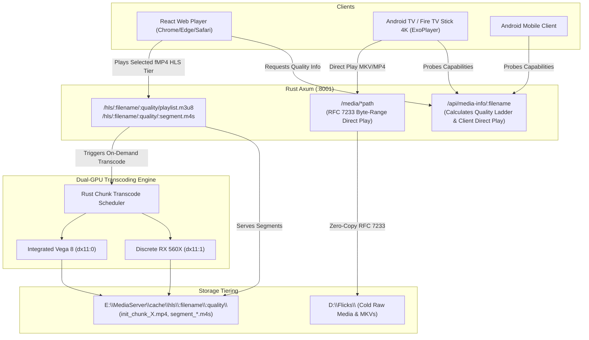

# Implementation Plan — Phase 8: Fragmented MP4 (fMP4) Streaming, Dynamic Quality Ladder & Android Direct Play

**Phase:** Phase 8 (Executed before Phase 7 Port Cutover)  
**Branch:** `feat/rust-fmp4-quality-ladder`  
**Governing Rules:** `AGENTS.md` §0.1, §0.2, §5; `GEMINI.md` §0, §1, §3, §15  
**Target Backend:** Rust / Axum (`:8001`)  
**Frontends:** React Web Player (`web/`) & Flutter Android/Fire TV (`flutter_client/`)

---

## 1. Executive Summary & Objectives

This phase modernizes the streaming and playback architecture of Anis' Home Media Server across three key pillars:

1. **Fragmented MP4 (`fMP4` / `.m4s`) HLS Pipeline**:
   * Migrate the HLS transcoding engine from legacy MPEG-2 Transport Stream (`.ts`) to **Fragmented MP4 (`.m4s`)** with `#EXT-X-MAP` initialization segments (`init.mp4`).
   * Unlocks native hardware-accelerated HEVC and H.264 video decoding in Chromium browsers (Chrome, Edge) and Safari via HTML5 Media Source Extensions (MSE) with zero JavaScript demuxing overhead.

2. **Dynamic Quality Ladder & In-Player Selectors (Strict No-Upscaling Invariant)**:
   * Provide user-selectable playback qualities in both the **React Web Player** and the **Flutter 10-foot TV / Mobile Player**.
   * Supported tiers: **4K (2160p)**, **2K (1440p)**, **1080p (FHD)**, **720p (HD)**, **480p (SD)**, **360p (Data Saver)**, and **Direct Play (Source)**.
   * **Strict No-Upscaling Invariant**: A video must **never** offer resolutions higher than its source height:
     $$\text{Allowed Resolutions} = \{ R \in [2160p, 1440p, 1080p, 720p, 480p, 360p] \mid R_{\text{height}} \le \text{source\_height} \}$$
     * *Example 1*: A 1080p movie offers `[Direct, 1080p, 720p, 480p, 360p]` (2K and 4K are strictly omitted).
     * *Example 2*: A 2K movie offers `[Direct, 2K, 1080p, 720p, 480p, 360p]` (4K is strictly omitted).
     * *Example 3*: A 4K movie offers `[Direct, 4K, 2K, 1080p, 720p, 480p, 360p]`.
   * **Strategy**: **Option A (On-Demand Single Stream)** — the server transcodes specifically the requested quality profile on-demand, maximizing dual-GPU efficiency and minimizing SSD cache consumption.

3. **Android Client MKV Direct Play Optimization**:
   * Currently, the server hard-codes `direct_play = false` for all `.mkv` files, forcing them into HLS transcoding even on Android TV / Fire TV Stick 4K devices whose hardware media decoders (ExoPlayer) natively support MKV containers.
   * Expand media probing and playback resolution to allow Android/Fire TV clients to **Direct Play** `.mkv` files natively over RFC 7233 byte-range streaming (`/media/{*path}`) with **0% server CPU and 0% GPU load**.

---

## 2. Architectural Blueprint & Data Flow



---

## 3. Detailed Scope of Changes

### Slice 1: Rust Backend Engine — fMP4 Packaging & Dynamic Quality Scaling
* **Files to modify**:
  * `rust/src/services/gpu_service.rs`:
    * Extend `get_ffmpeg_video_args()` to accept a target height `target_height: Option<u32>`.
    * Generate dynamic AMF VPP scaling filter: `vpp_amf=h='min({target_height},ih)':w=-2:format=nv12` (or CPU `scale=-2:{target_height}:force_original_aspect_ratio=decrease,format=yuv420p`).
    * Retain strict 8-bit `format=nv12` color depth to ensure compatibility with installed AMD drivers (< 23.30).
  * `rust/src/services/transcode_worker.rs`:
    * Update `execute_single_chunk()` FFmpeg command arguments:
      * Add `-hls_segment_type fmp4`
      * Set `-hls_fmp4_init_filename init_chunk_{chunk_id}.mp4`
      * Set `-hls_segment_filename segment_%06d.m4s`
    * Update output parsing to handle `.m4s` segment outputs and initialization boxes.
  * `rust/src/services/chunk_transcode.rs`:
    * Update segment layout and playlist assembly to emit `#EXT-X-VERSION:7` and `#EXT-X-MAP:URI="init_chunk_{chunk_id}.mp4"` at chunk boundaries.
    * Incorporate quality subpaths into the cache directory structure:
      `cache/hls/{relative_filename}/{quality_label}/` (e.g. `1080p`, `720p`, `480p`, `source`).
    * Implement cache reconciliation to prevent cross-quality collisions.

### Slice 2: Rust API Contracts — Dynamic Quality Ladder & Android Direct Play
* **Files to modify**:
  * `rust/src/routes/media_info.rs`:
    * Implement quality ladder generation based on FFprobe `height`:
      ```rust
      pub struct QualityOption {
          pub label: String,      // "4K", "2K", "1080p", "720p", "480p", "360p", "Direct"
          pub height: u32,        // 2160, 1440, 1080, 720, 480, 360, 0
          pub bitrate: u64,       // estimated target bitrate (bps)
          pub is_direct: bool,    // true for direct play
      }
      ```
    * Filter candidates: retain only options where `height <= source_height`. Always prepend or include `Direct Play (Source)`.
    * Expand `direct_play` evaluation:
      * Add client-aware detection (`User-Agent` / `X-Client-Platform` header / query `?client=android`).
      * When client is Android / Fire TV, treat `.mkv` files containing H.264/HEVC and AAC/AC3/EAC3 audio as `direct_play = true`.
  * `rust/src/routes/hls.rs`:
    * Update route matchers to support quality tiers:
      `GET /hls/{*path}/playlist.m3u8`
      `GET /hls/{*path}/:segment` (serving both `.m4s`, `init*.mp4`, and legacy `.ts`).
    * Set proper MIME types:
      * `.m4s` → `video/iso.segment`
      * `init*.mp4` → `video/mp4`
      * `.m3u8` → `application/vnd.apple.mpegurl`

### Slice 3: React Web Frontend — In-Player Quality Selector
* **Files to modify**:
  * `web/src/features/playback/PlayerControlsRow.tsx` & `PlayerPage.tsx`:
    * Add a dedicated **Quality Selector Button** (`HD` / `⚙` icon) to `.controls-row` between Speed and Subtitles.
    * Render a sleek frosted-obsidian quality selection popover / modal matching the obsidian design system:
      * Shows available quality items from `media_info.quality_ladder`.
      * Displays active indicator (checkmark or brand red highlight).
      * Supports `"Auto"` (default) and explicit pinned resolutions.
    * When switching quality:
      * Preserves playback position (`v.currentTime`) and playback state (`playing`).
      * Re-points `Hls.js` or direct source smoothly.
  * `web/src/features/playback/NerdStatsHud.tsx`:
    * Update telemetry HUD to display active stream container (`fMP4`), current resolution tier, and dropped frames.

### Slice 4: Flutter Client — Android Direct Play & TV Remote Quality Modal
* **Files to modify**:
  * `flutter_client/lib/features/player/infrastructure/player_media_resolver.dart`:
    * Update `PlaybackMode` determination: pass `X-Client-Platform: android` header to `/api/media-info`.
    * Default to Direct Play for `.mkv` media when `direct_play = true`.
  * `flutter_client/lib/features/player/presentation/player_screen.dart` & `tv_player_focus.dart`:
    * Add Quality Selector action into Zone 2 (Controls rail).
    * Render D-pad focusable modal dialog (`TvQualityDialog`) displaying the dynamically filtered quality ladder.

### Slice 5: UI/UX Terminology Modernization & HLS Label Retirement
This slice replaces internal/legacy developer jargon ("HLS", "MPEG-TS", "HLS Transcode") across all user-facing web and mobile views with modern, consumer-friendly streaming terminology ("Adaptive Stream (fMP4)", "Stream Ready", "Direct vs Adaptive", "Transcode Cache").

* **Target UI/UX Element Replacements**:
  1. **Player Playback Mode Badge** (`web/src/features/playback/PlayerPage.tsx` & `flutter_client/.../playback_mode.dart`):
     * *Current*: `"HLS Stream"` / `'HLS STREAM'` / `'HLS Segmented'`
     * *Modernized*: **`"Adaptive Stream"`** (or **`"Adaptive (fMP4)"`** in technical views).
  2. **Player Preloader & Transcode Waiting Gate** (`web/src/features/playback/TranscodeGate.tsx`, `PlayerPreloader.tsx`):
     * *Current*: `"Please wait a moment while the server finalizes all HLS chunks..."` / `"Preparing Dual-GPU HLS streams..."`
     * *Modernized*: **`"Please wait a moment while the server finalizes stream segments..."`** / **`"Preparing Adaptive Dual-GPU Stream..."`**
  3. **Quality Selector Options** (`web/src/features/playback/QualitySelectorModal.tsx` & `flutter_client/.../quality_selector_sheet.dart`):
     * *Current*: `"Auto (Adaptive HLS)"`
     * *Modernized*: **`"Auto (Adaptive)"`** with subtext *"Dynamically scales resolution based on bandwidth"*.
  4. **Home Spotlight Badge** (`web/src/features/library/HeroSpotlight.tsx`):
     * *Current*: Badge: `"HLS"`
     * *Modernized*: Badge: **`"Adaptive"`** (paired with 4K/1080p resolution badges).
  5. **Active Transcodes Telemetry Card** (`web/src/features/library/ActiveTranscodes.tsx`):
     * *Current*: `mode: 'HLS Transcode'`
     * *Modernized*: `mode: 'Adaptive Stream (fMP4)'`.
  6. **Manage Library Inventory Filters & Badges** (`web/src/features/manage/ManagePage.tsx`, `InventoryToolbar.tsx`, `InventoryList.tsx`):
     * *Current*: Filter: `{ id: 'hls', label: 'HLS / MKV' }` → *Modernized*: **`{ id: 'transcoded', label: 'Transcoded / MKV' }`** or **`{ id: 'adaptive', label: 'Adaptive / MKV' }`**.
     * *Current*: Badges: `"HLS Cached"`, `"⚙ On-Demand HLS"` → *Modernized*: **`"Stream Ready"`**, **`"⚙ On-Demand Stream"`**.
     * *Current*: Count badge: `"${activeHlsMap.size} HLS Cached"` → *Modernized*: **`"${activeHlsMap.size} Stream Ready"`**.
  7. **Manage Retention Policy & Delete Dialogs** (`web/src/features/manage/components/RetentionPolicyCard.tsx`, `DeleteConfirmationModal.tsx`):
     * *Current*: References to `"HLS transcode cache"`, `"fast SSD HLS stream caches"`.
     * *Modernized*: **`"stream transcode cache"`**, **`"fast SSD stream caches"`**.
  8. **User Manual Documentation** (`web/src/features/manual/ManualPage.tsx` & `docs/MANUAL.md`):
     * Update architectural references from legacy HLS MPEG-TS to **Fragmented MP4 (fMP4) Adaptive Streaming**.

---

## 4. Exit Criteria & Checkable Gates

| Gate | Checkable Criterion | Verification Method |
| :--- | :--- | :--- |
| **Gate 8.1 (fMP4 Transcode)** | Rust chunk worker renders `.m4s` segments and `init.mp4` with `#EXT-X-MAP` tags. | Automated test rendering a test chunk; verify files on disk and ffprobe container. |
| **Gate 8.2 (No-Upscaling Ladder)** | `/api/media-info` for a 1080p source returns only $\le 1080\text{p}$ options; 4K source returns $\le 2160\text{p}$ options. | Rust unit test asserting `quality_ladder` output across 480p, 720p, 1080p, 1440p, and 2160p sample probes. |
| **Gate 8.3 (Android Direct Play)** | Android client request for MKV file receives `direct_play = true` and streams directly via `/media/{*path}` with 0% server transcode load. | API contract test with `X-Client-Platform: android` header; confirm zero spawned transcode jobs. |
| **Gate 8.4 (Web Player Quality Switch)** | User clicking quality option in web player switches resolution without resetting seek position or crashing Hls.js. | Headless E2E Selenium test verifying quality toggle and video playback continuity. |
| **Gate 8.5 (UI/UX Terminology Modernization)** | Zero user-facing instances of raw "HLS" in player badges, manage tables, or quality menus; modern "Adaptive" / "Stream Ready" displayed. | Web component tests and visual inspection across Library, Details, Player, and Manage pages. |
| **Gate 8.6 (Regression & Contract Safety)** | All 254 Rust tests pass, Android probe (`22/22`) passes, and existing `.ts` caches remain playable. | Full execution of `cargo test` and `scripts/probe_android_api.py`. |

---

## 5. Potential Risks & Mitigations

1. **Risk: Legacy `.ts` Cache Incompatibility**:
   * *Mitigation*: The HLS route handler in `rust/src/routes/hls.rs` will inspect the requested file extension: if `.ts` is requested, it serves the legacy transport stream; if `.m4s` or `init*.mp4` is requested, it serves the fMP4 segment. Existing completed caches remain 100% playable.
2. **Risk: Multi-Quality Disk Cache Explosion**:
   * *Mitigation*: With Option A (On-Demand), only requested qualities are generated. The cache maintenance worker (`audit_orphaned_caches` / `purge_orphaned_caches`) will recognize sub-quality folders and safely clean unreferenced quality caches.
3. **Risk: Browser MSE Buffer Stall on Quality Switch**:
   * *Mitigation*: When switching quality on-demand in the React player, the player captures `currentTime = video.currentTime`, swaps the playlist URL, and restores `currentTime` upon `loadedmetadata` / `canplay`, preventing `0:00` resets.
4. **Risk: 10-bit Color Incompatibility on AMD GPUs**:
   * *Mitigation*: Strict enforcement of `format=nv12` (8-bit) in FFmpeg video filters (`vpp_amf=format=nv12`), avoiding driver crashes on AMD driver versions lower than 23.30.

---

## 6. Execution Sequence & Slices

```
[Phase 8 Approval]
       │
       ├──► Slice 1: Rust fMP4 Transcode Engine & Quality Scaling (`gpu_service.rs`, `transcode_worker.rs`, `chunk_transcode.rs`)
       │
       ├──► Slice 2: Rust API Quality Ladder & Android Direct Play (`media_info.rs`, `hls.rs`)
       │
       ├──► Slice 3: React Web Player In-Player Quality Selector (`PlayerControlsRow.tsx`, `PlayerPage.tsx`, `QualitySelectorModal.tsx`)
       │
       ├──► Slice 4: Flutter Android & Fire TV Direct Play + Remote Modal (`player_media_resolver.dart`, `player_screen.dart`, `quality_selector_sheet.dart`)
       │
       ├──► Slice 5: UI/UX Terminology Modernization & HLS Label Retirement (`HeroSpotlight.tsx`, `ActiveTranscodes.tsx`, `ManagePage.tsx`, etc.)
       │
       └──► Verification: End-to-End Live Transcode, Android Contract Probe, and Full Test Suites
```

---

*End of Implementation Plan.*
